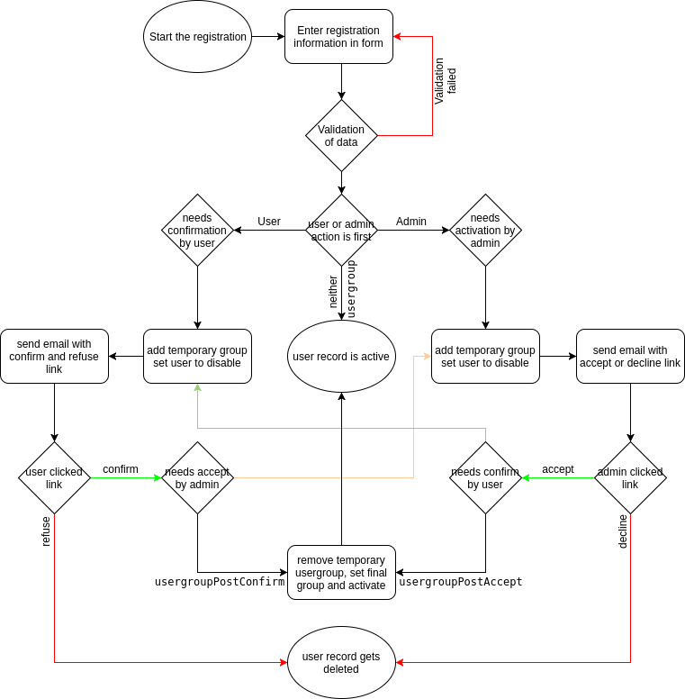

# Registration actions {#registration-actions}

## Possible actions {#possible-actions}

The following diagram displays which actions are necessary for a successful registration. Some of them are optional like
the confirmation and activation. Some are mandatory to get a valid user to login with.

### Screenshots: {#screenshots}

