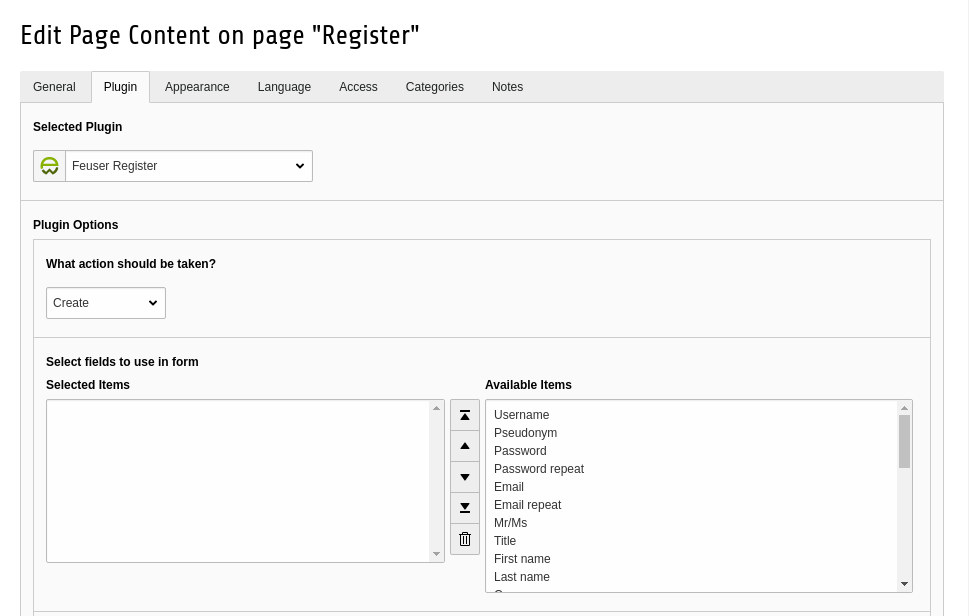

# Users manual {#user-manual}

Here you get information on how to use the content element

## Changing sorting of fields {#changing-sorting-of-fields}

To change the order of fields its not necessary to edit the html template. It
could be either done via TypoScript (which needs administrativ rights) or by
the editor alone.

For an editor its as easy as selecting the fields in the plugin and then order
them in the field selection. The screenshot below shows the select field.

### Screenshots {#screenshots}

